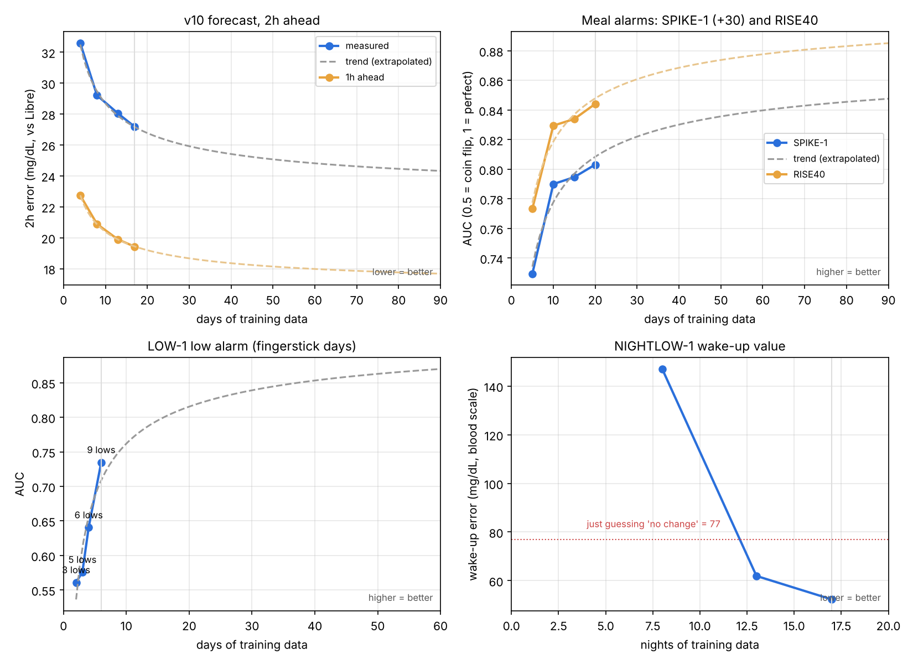

# Personal Glucose Forecasting

An end-to-end system that forecasts my own blood glucose 1 to 2 hours ahead, from raw sensor data to models to phone alarms. Over about 3 months (Aug to Nov 2026) I collected my own data, wrote an Android app to log a smartwatch over reverse-engineered Bluetooth, and trained and fairly tested more than 15 model versions.

- **Best live model (1h / 2h):** RMSE 20.5 / 28.3 mg/dL, about 15% better than persistence.
- **Best forecast (vs CGM, 2h):** RMSE 25.4 mg/dL (digital twin + hybrid blend) vs 27.6 for the live model and ~32 with no meal input.
- **Alarms:** a low-glucose alarm caught 8 of 10 real lows 2 hours ahead (leave-one-day-out); a rise alarm warned for 40 of 48 large rises.
- **Rigor:** every model scored with walk-forward or leave-one-day-out tests, using only what is known at forecast time. Most ideas did not beat the simple model, and I kept them out of production.

> Research project only. Not medical advice; never use for insulin dosing.
> No personal health data is included. See [docs/DATA_FORMAT.md](docs/DATA_FORMAT.md) for the input format.

## Repo layout

| Folder | What's inside |
|---|---|
| [`experiments/`](experiments/) | Every model version (v2 to v15, GRU, mixture of experts, digital twin, alarms) with code and a `NOTE.md` per model |
| [`live/laptop/`](live/laptop/) | Python uploader + forecaster with plug-in model folders |
| [`apps/watch-logger/`](apps/watch-logger/) | Android (Kotlin) BLE logger for a Noise smartwatch |
| [`apps/glucose-alarms/`](apps/glucose-alarms/) | Android (Kotlin) app running the alarm models offline |
| [`analyses/`](analyses/) | Learning curves, sample-size planning, insulin timing, injection site, model explainer |
| [`results/`](results/) | Alarm confusion matrices |

## Problem

People on insulin must guess where their glucose will be after a meal or a dose. Given the last glucose reading, smartwatch data, and the meals and insulin about to happen, predict glucose 15 minutes to 4 hours ahead, and raise alarms for lows and spikes.

What makes it hard:
- **Tiny data, one person:** 19 days of CGM at the start, growing to ~45 logged days.
- **Noisy labels:** my sensor reads ~30% off finger-prick blood tests (measured).
- **Messy inputs:** meals logged as free text, often in Indian cooking terms.
- **Three input setups:** A (CGM + watch + food/insulin), B (finger-prick meter + watch + food/insulin), C (meter + food/insulin only).

## Data and the watch logger app

| Source | What it gives | How I got it |
|---|---|---|
| FreeStyle Libre CGM | Glucose every 15 min | LibreView CSV exports, later a USB uploader |
| Finger-prick glucometer | Accurate blood glucose, a few per day | Logged by hand; treated as ground truth |
| Noise smartwatch | Heart rate, steps, distance, calories every 30 s | My own Android app |
| Food and insulin log | Free-text meals with times, insulin doses | Daily text files, parsed into rows |
| Public datasets | Shanghai T1DM, HUPA-UCM, UCH | Compiled for pretraining tests |

**Android BLE logger (Kotlin).** The watch had no open API, so I reverse-engineered its Bluetooth Low Energy protocol and wrote an app that records heart rate, steps, distance and calories every 30 seconds to CSV. It has a foreground service, staged reconnection recovery, a cycling mode that ignores false steps, and a read-only share of the logs for other apps.

**Meal parser.** A food database (carbs, sugar, fiber, fat, protein, glycemic index and load from published tables) plus a parser that turns lines like `2 roti + dal, 4u` into nutrients and doses, including local terms such as "cooked in Indian style".

## Fair evaluation design

With so little data it is easy to fool yourself, so I fixed the test rules early and scored every model the same way.

1. **Walk-forward and leave-one-day-out splits.** A model never sees the test day, or any later day, in training.
2. **Planned-meal input.** The model gets the meals and insulin that actually happen inside the forecast window, as a person logs them right before eating.
3. **No leakage.** Later correction doses and post-meal readings are excluded from features that predict that meal.
4. **Baselines every time.** Persistence and the current live model are scored on the same windows.
5. **Blood as truth.** Finger-prick readings get 5x weight in training; CGM is trusted for trend and night shape.
6. **Noise check.** Gains under ~1 mg/dL on a few test days are called "within noise", not wins.
7. **Sample size.** Learning curves plus the Riley (2020) sample-size method to estimate how much data each model needs.

## Model progression

The core model is a hybrid: a small, sign-constrained "body model" (about 9 interpretable numbers such as mg/dL per unit of insulin and per gram of fast sugar, fit with bounded least squares) plus gradient-boosted trees on its residuals. Food enters through absorption curves by carb type. Bigger models were tested against it under the same rules.

RMSE in mg/dL, 1h / 2h ahead. Numbers are only comparable within a row (each row names its test set).

| Date | Model | Idea | Result (1h / 2h) | Verdict |
|---|---|---|---|---|
| Nov 23 | Digital twin GLU-T | Physiological ODE (insulin, 5 gut-absorption channels, fat slowing), 32 bootstrap members, 80% ranges | 2h 26.0; blend with v14 25.4 vs v14 27.1 / live 27.6 (CGM) | Best on CGM; research |
| Nov 22 | GRU GLU-G | Recurrent net on CGM mapped to blood with gap filling | 2h 44.7 vs live 41.7 (finger-pricks) | No gain |
| Nov 22 | v15 | Liver and muscle glycogen "tank" | 2h 43.2 vs v14 41.3 | No gain |
| Nov 21 | v14 | Carbs split into 5 food families with own absorption shapes | 2h 41.3 vs live 48.7 (new-food set) | Best on new foods |
| Nov 16 | CTX3D | 0 to 3 days of past context | No real gain | Dropped |
| Nov 14 | v11 | Finger-pricks weighted 5x | 21.8 / 35.7 vs 22.0 / 37.3 | Within noise |
| Nov 1 | **v10 (live)** | + fiber and exercise features | **20.5 / 28.3** | Live model |
| Nov 1 | v8 | Meter-only model + planned meals + 15-min watch features | 20.7 / 28.6 vs 22.0 / 32.0 | Big step |
| Oct 31 | v7 | 15-min heart rate, raw steps and calories | 21.2 / 28.8 vs 21.3 / 29.0 | Within noise |
| Oct 31 | MoE v6 | Mixture of experts (spike vs stable) | 1h 20.3 vs 21.0, spikes not fixed | Dropped |
| Oct 30 | v5 | Planned meals for the full horizon | 21.0 / 29.0 vs 21.5 / 31.4 | Kept |
| Oct 29 | Public pretraining | Pretrain on public T1D data, fine-tune on mine | 1h 22.2 vs own ridge 21.3 | No gain yet |
| Oct 29 | v4 | Glycemic index/load, absorption kernels, quantile ranges | Same RMSE, honest 80% ranges | Kept for ranges |
| Oct 29 | v2 / v3 | Ridge + engineered meal features | 2h 31.7, ~15% better than persistence | First baseline |

**Main lesson:** on ~20 to 45 days of one person's data, structure (physiology, absorption shapes, fair inputs) beat model size. A GRU, a mixture of experts and public-data pretraining all lost to the small hybrid.

## Alarm models

Average error hides the moments that matter, so I built separate classifiers for lows and spikes. All scores are leave-one-day-out or on unseen later data. Full confusion matrices: [`results/alarm_confusion_matrices.csv`](results/alarm_confusion_matrices.csv).

| Alarm | Predicts | Method | Score |
|---|---|---|---|
| LOW-1 | Glucose below 70 within 2h | Logistic regression on insulin on board, meal macros, watch | Caught 8/10 lows, 25% false alarms; failed on a later unseen week (precision 13%) |
| SPIKE-1 | Post-meal rise band: <30 / 30-60 / 60+ | Logistic on uncovered carbs, insulin on board, heart rate, steps | Caught 8/12 spikes, 4/16 false (blood) |
| RISE40 | Rise of 40+ and when it starts and peaks | Logistic + time ranges | Warned for 40/48 CGM rises, ~1 in 5 false |
| NIGHTLOW-1 | Hourly overnight path and low risk at bedtime | Sign-limited linear model per hour | Wake-up error 52 vs 77 for no-change; too few nights to trust |

An honest finding: a simple dosing rule of thumb matched or beat SPIKE-1 on the newest unseen week. I reported that instead of hiding it, and kept the alarms as research tools. Learning curves show LOW-1 needs ~115 lows, not 10, to be reliable.

## Analyses and findings

- **Sensor accuracy.** 31 paired CGM and finger-prick readings gave MARD 30.2%, bias -45 mg/dL. A per-sensor calibration cut sensor error to 19% MARD and forecast error vs blood from 77 to 52 at 2h. Label noise, not the model, sets the floor.
- **Why forecasts miss.** I classified 67 big misses: meal effect size or timing wrong 30%, rebound after low treatment 25%, late peaks after high-fat dinners 18%, corrections 15%. Knowing meals 2h ahead only cut 2h error from 31.9 to 28.9, so the gap is in how food acts, not whether it is known.
- **Spikes.** Across 59 spikes, meals with less than 1 unit of insulin per 8 g carbs spiked 77% of the time vs 23% otherwise.
- **Model internals.** Permutation importance at 2h: insulin +22 RMSE, fat/protein +10.5, fast carbs +6.5, watch +4.6. Forecasts moved only ~0.5x as far as real swings, which explained the lag.
- **How much data.** Learning curves (30 to 40 random repeats) project 2h error ~26 at 30 days, ~24 at 90, floor ~22. Riley sample-size math sets targets of ~115 lows and ~450 meals. See [`analyses/data-needs/how-much-data.md`](analyses/data-needs/how-much-data.md).
- **Negative tests.** Injection site, glycogen tank, 2-day look-back, time-of-day features and exercise lag features all made models worse and were dropped.

## Live system

1. **Laptop uploader (Python, Windows).** The phone has no NFC, so a script reads the CGM reader over USB and pushes readings to Firebase Firestore (REST, auth + security rules).
2. **Plug-in model folders.** Each model ships as a folder with an `adapter.py` and a model card; the forecaster loads whichever is marked active (v10 live, v8 and A v5 installed).
3. **Cloud first, then offline.** The final setup is fully offline for privacy.
4. **Glucose Alarms app (Kotlin).** Separate from the logger. Runs LOW-1, SPIKE-1, RISE40 and NIGHTLOW-1 on the phone, reads watch CSVs read-only, uses only pickers and steppers (no typing), and logs every alarm for later scoring.
5. **Parity tests.** The Kotlin port of the models is checked against Python golden values (`AlarmCoreTest.kt`), so phone and lab give the same numbers.

Every model is versioned with a card: name with inputs and date, "problem -> solution, why", inputs, outputs, pros and cons.

## Lessons

- **Small data rewards structure.** Physiology-based features and constraints beat deep and pretrained models at this scale.
- **Fix the evaluation first.** Planned-meal input and day-level splits changed which models looked good.
- **Measure the labels.** Checking the sensor against blood showed that much of the "model error" was sensor error.
- **Report what fails.** About two thirds of experiments gave no gain. Each was logged with its numbers and kept out of production.
- **Next steps.** More lows and nights for the alarms, a more accurate sensor, and clean single-food tests for absorption shapes.

## Skills shown

| Area | Skills and tools |
|---|---|
| Machine learning | Ridge, bounded least squares, gradient boosting, logistic regression, GRU (PyTorch), mixture of experts, quantile ranges, bootstrap ensembles, transfer learning |
| Modeling | Physiological ODE digital twin (SciPy, Numba), absorption kernels, domain-driven feature engineering |
| Evaluation | Walk-forward and leave-one-day-out tests, leakage control, baselines, confusion matrices, AUC, learning curves, sample-size planning |
| Data engineering | Time-series alignment of 4 sources, free-text meal parsing, gap filling, sensor calibration, pandas |
| Software | Android (Kotlin) BLE reverse-engineering, foreground services, Python uploader, Firebase, model packaging and versioning, cross-language parity tests |

## Earlier work

The [GRU project at the root of this repo](../README.md) was trained on public T1D datasets (HUPA, Shanghai, UCH). This project grew out of it.
